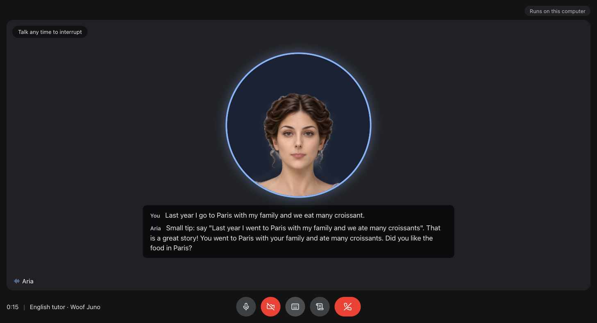
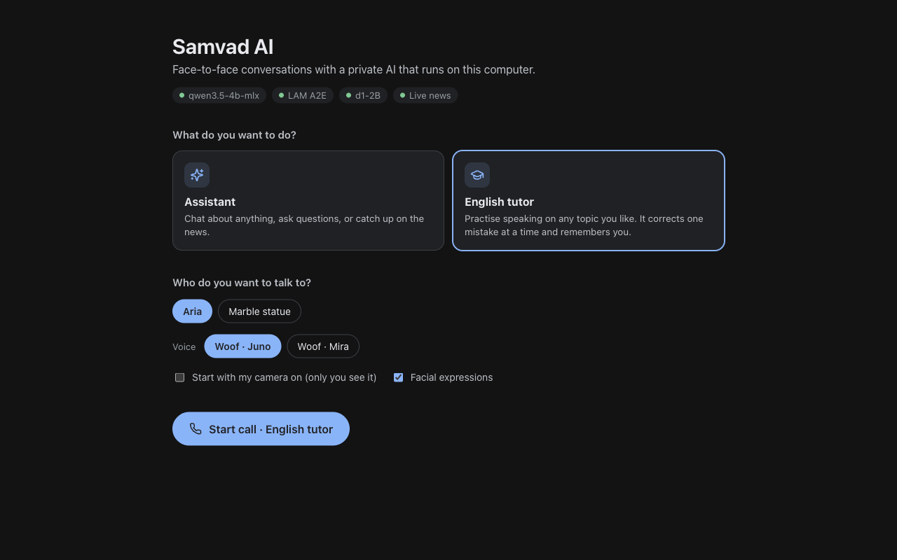

# Samvad AI

*Samvad (संवाद) is Sanskrit for "conversation".*

Video-call an AI that runs on your own computer. A photo-real head listens,
talks back and moves its face in time with its speech. The models run locally.
Only questions you ask with live search switched on are sent to the web.



Two ways to use it:

| Mode | What it does |
| --- | --- |
| **Assistant** | Chat and ask questions. With live search on, it also answers about news and other things that change. |
| **English tutor** | Asks what you'd like to talk about, follows your topic, and gently corrects one clear mistake at a time. It remembers your recent mistakes and a little about you between calls. |

Every mode also has **scripted rehearsal**: write a dialogue (`You:` / `Agent:`
lines), then either have your lines read aloud in the other voice or say them
yourself. After a call, the transcript is shown.



## How a turn works

```
your voice ─► Silero VAD ─► Parakeet ─► d1-2B ─┬─► brain ───────────────► Woof voice ─► face (LAM A2E)
             (is it speech?) (words)  (route) └─► web search ─► brain ─┘
```

1. **Silero VAD** (in the browser) starts a turn only on a human voice, not clicks, typing or hums.
2. **Parakeet TDT 0.6B** turns your speech into text on the CPU in about 0.15 s.
3. **d1-2B**, Liquid AI's decision model, routes the request in about 0.1 s: small talk, knowledge, maths and time, or something current that needs a search.
4. **The brain** writes the reply. Questions about current things are answered from a [Tavily](https://tavily.com) web search, with a short "let me check" line said right away.
5. **Underdog Woof** speaks it sentence by sentence, and **LAM A2E** moves the face in time with the voice.

Talking over a reply cancels it everywhere.

## Get started

Requirements: macOS on Apple silicon (or Linux), Node 23.6+ (the server is
TypeScript run directly by Node), Python 3 with numpy (for the voice), about
5 GB of free disk space, and a microphone. Headphones help a lot.

```bash
git clone https://github.com/znikhil/samvad-ai.git && cd samvad-ai
npm install
npm run setup      # one time: downloads the engine and models (resumable)
npm run build
npm start          # opens http://127.0.0.1:8190
```

`npm run setup` downloads, into `~/Library/Application Support/SamvadAI`:

| Part | Source | Size |
| --- | --- | --- |
| llama.cpp engine | [ggml-org/llama.cpp](https://github.com/ggml-org/llama.cpp) latest release | ~40 MB |
| d1-2B (routing) | [LiquidAI/d1-2B-GGUF](https://huggingface.co/LiquidAI/d1-2B-GGUF) | 1.7 GB |
| Parakeet TDT 0.6B v2 (hearing) | [sherpa-onnx](https://github.com/k2-fsa/sherpa-onnx) release | 0.6 GB |
| Underdog Woof (voice) | [ConwayResearch/Underdog-Woof](https://huggingface.co/ConwayResearch/Underdog-Woof) | 40 MB |
| LAM A2E (lip sync) | [myned-ai/wav2arkit_cpu](https://huggingface.co/myned-ai/wav2arkit_cpu) | 0.4 GB |
| LFM3 1.7B (brain, only without `LIVE_BRAIN_URL`) | [LiquidAI/LFM3-1.7B-GGUF](https://huggingface.co/LiquidAI/LFM3-1.7B-GGUF) | 1.1–1.7 GB |

Parts already downloaded are skipped, and an interrupted download resumes
where it stopped. Choose the brain's size with
`npm run setup -- --size small|balanced|best` (default: balanced).

### A stronger brain (recommended)

LFM3 1.7B works out of the box. For better answers, run **Qwen 3.5 4B** in
[LM Studio](https://lmstudio.ai) and point the app at it in a `.env` file in the
project folder (it's git-ignored):

```bash
LIVE_BRAIN_URL=http://127.0.0.1:1234/v1
LIVE_BRAIN_MODEL=qwen3.5-4b-mlx
LIVE_BRAIN_NO_THINK=1   # Qwen thinks before every answer otherwise; this makes it answer at once
```

With it, replies start in about a second. Only one brain is ever loaded.

### Optional: live search

With a [Tavily](https://tavily.com) API key in `.env`, the Assistant can answer
questions about news and other things that change (headlines, scores, weather,
prices):

```bash
TAVILY_API_KEY=tvly-...
```

A **Live search** switch then appears on the start screen. Only questions that
need a search are sent to Tavily; everything else stays on your computer.
Answers about current things take about 2–3 seconds. Asked what's trending on
a social network, Aria says she can't see its live trends, and tells you
today's top stories instead.

### Settings

| Variable | Default |
| --- | --- |
| `LIVE_PORT` | `8190` |
| `LIVE_HOME` | `~/Library/Application Support/SamvadAI` (models, logs, tutor notes) |
| `LIVE_BRAIN_URL`, `LIVE_BRAIN_MODEL` | LFM3 1.7B on `http://127.0.0.1:8180/v1` |
| `LIVE_BRAIN_NO_THINK` | off (set `1` for Qwen 3.5) |
| `TAVILY_API_KEY` | unset (live search off) |
| `LIVE_PYTHON` | `python3` (runs the Woof voice) |
| `LIVE_LAUNCH_MODELS` | `1` (set `0` to use llama.cpp servers you run yourself) |
| `LIVE_OMNI` | off (see below) |

**LFM3 Omni 2B**, a speech-to-speech model with sight, is still supported but
never loaded by default, to save about 4 GB of memory. With `LIVE_OMNI=1`,
setup downloads it, and it adds Omni's own voice and lets the AI see your
camera. Without it, the camera is a self-view only: no pictures are sent to
the AI.

## How it's built

```
shared/protocol.ts        the browser <-> server contract, imported by both sides
server/
  main.ts                 HTTP + WebSocket entry, security (localhost, origin, token, CSP)
  config.ts               every setting, from env vars
  news.ts                 Tavily web search
  models/                 llama.cpp runtime, the brain, d1-2B router, Parakeet, Woof, Omni
  woof/woof_server.py     the Woof voice as a small local HTTP service
  setup/                  `npm run setup`: what to download and the resumable downloader
  call/session.ts         one call: hears each turn, routes it, owns interruption (epochs)
  call/brain-responder.ts the brain answering a call (Omni's realtime session when it's on)
  call/speech.ts          speech out: sentence by sentence, length cap, face sync
  face/                   LAM A2E (speech -> 52 face shapes) and emotion labels
  modes/                  assistant and tutor behind one `Mode` interface
web/src/
  call/CallClient.ts      the call in the browser, no React: mic, turn taking, speech, camera
  call/ScriptRunner.ts    scripted rehearsal on top of CallClient
  audio/                  mic worklet, speech detector + Silero VAD, gapless player
  avatar/                 catalog, LAM head renderer, expression mixer
  components/             Lobby, CallScreen (+ ControlBar, Captions, SelfView, …), Summary
```

**Adding a mode:** write a `ModeDefinition` in `server/modes/` (its
instructions, and optionally `opener`, `answer` and `end`), then list it in
`modes/index.ts`. The lobby picks it up from `/api/status`.

**Adding an avatar:** put a LAM ZIP in `web/public/avatars/` and add it to
`web/src/avatar/catalog.ts`.

## Limits

- Other people talking nearby, or a TV, still count as a voice.
- Without headphones, the mic can hear the reply and start a false turn. Interrupting needs louder speech to reduce this.
- Mira, the second Woof voice, is slower than Juno and occasionally fails on a sentence (it's then retried).
- Small local models make mistakes. The tutor's grammar corrections are helpful, not authoritative.

## Avatars and licences

**Aria** was generated for this project with [LAM](https://github.com/aigc3d/LAM)
(Large Avatar Model) on our own GPU, from a single AI-generated portrait. **Marble** is a
sample head from Alibaba's [OpenAvatarChat](https://github.com/HumanAIGC-Engineering/OpenAvatarChat).
Both are Gaussian-splat heads on the [FLAME](https://flame.is.tue.mpg.de/) head model, which
is licensed for **non-commercial use only**. Underdog Woof's licence is also
**non-commercial**, and Parakeet is CC-BY-4.0. The app's code is MIT. The models
are under their own licences on Hugging Face.
